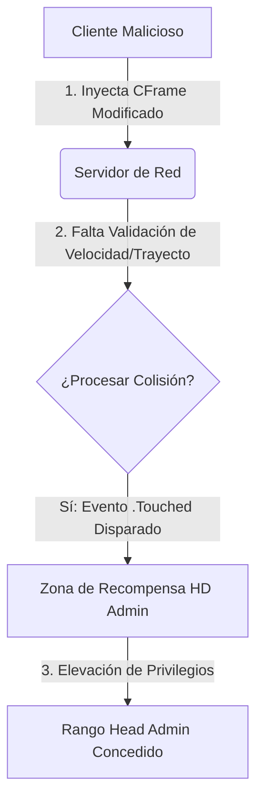

# 🎮 Auditoría de Seguridad GameDev: Explotación de Lógica Cliente-Servidor en HD Admin

---

## 📌 1. Resumen Ejecutivo

Este documento presenta un análisis técnico detallado de una vulnerabilidad de lógica de negocio y replicación de red insegura identificada históricamente en la integración del sistema de gestión **HD Admin** dentro del videojuego *Bridge Worm*. 

> ⚠️ **Nota de Arquitectura:** La brecha de seguridad analizada no explota una corrupción de memoria o un desbordamiento de búfer tradicionales. Se trata de una **falla de diseño arquitectónico basada en la confianza ciega del lado del cliente**. 

Al aceptar de forma nativa las coordenadas replicadas por el cliente, el sistema permitía a actores maliciosos teletransportarse de forma asíncrona a zonas restringidas de recompensa física, logrando una elevación de privilegios inmediata al rango máximo del servidor (`Head Admin`).

---

## 🔬 2. Anatomía del Vector de Ataque

El exploit documentado utiliza una rutina de manipulación de coordenadas tridimensionales sobre la propiedad `CFrame` (Coordinate Frame) de la entidad raíz del personaje, forzando una colisión artificial seguida de un ciclo de reinicio de estado.

### 💻 Script del Exploit (Luau)

```lua
-- =============================================================================
-- PASO 1: Teletransporte inmediato al nodo de colisión oculto del mapa
-- =============================================================================
game.Players.LocalPlayer.Character.HumanoidRootPart.CFrame = CFrame.new(-17014, 71, -1186)
task.wait() -- Forzado de sincronización física de un fotograma en la red

-- =============================================================================
-- PASO 2: Teletransporte secundario de validación intermedia
-- =============================================================================
game.Players.LocalPlayer.Character.HumanoidRootPart.CFrame = CFrame.new(-1657, 114, -1317)
task.wait(1) -- Retraso programado para asegurar el guardado de la sesión en el servidor

-- =============================================================================
-- PASO 3: Ruptura del ciclo de vida y forzado de Respawn
-- =============================================================================
game.Players.LocalPlayer.Character.Humanoid.Health = 0
```

### ⚙️ Mecanismo de Explotación Paso a Paso

1. **Manipulación de Física en el Cliente:** El atacante modifica la propiedad `CFrame` de su `HumanoidRootPart` inyectando vectores de posición específicos en la memoria del juego.
2. **Abuso de la Replicación de Red (Network Ownership):** Debido a que el motor delega las físicas del personaje al cliente para reducir la latencia, el servidor acepta la nueva posición sin validar la velocidad del trayecto ni verificar si existieron obstáculos en la trayectoria.
3. **Activación del Callback:** El servidor detecta la superposición física a través del evento `.Touched` del bloque sensor de HD Admin, disparando inmediatamente la función interna de asignación de privilegios: `SetRank(player, "HeadAdmin")`.
4. **Persistencia por Fuerza Bruta:** Al forzar `Health = 0`, el personaje pasa por un proceso de *Respawn*. Esto limpia el estado físico del personaje y lo regresa al mapa común, pero las variables lógicas del rango de Administrador ya han quedado consolidadas y persistidas en la sesión activa del servidor.

---

## 📉 3. El Flujo de Confianza Insegura

El problema fundamental radica en la violación del principio de seguridad: **"Nunca confíes en el cliente"**. El flujo del exploit opera de la siguiente manera:



*Nota: Al otorgar el Network Ownership del personaje al cliente, el servidor asume que los datos vectoriales recibidos son legítimos, permitiendo el bypass de barreras geográficas dentro del espacio tridimensional.*

---

## 🛡️ 4. Mitigación y Programación Segura

Para corregir esta vulnerabilidad de forma definitiva, se deben remover las dependencias de control de acceso basadas en la posición física tridimensional. A continuación se presentan las dos directrices defensivas recomendadas:

### A. Validación de Distancia y Velocidad Máxima (Anti-Teleport)
El servidor debe implementar un hilo de verificación que calcule la distancia Euclidiana entre la posición previa ($P_1$) y la posición actual ($P_2$) del jugador en un delta de tiempo ($t$).

La distancia se evalúa mediante la fórmula:

$$d = \sqrt{(x_2 - x_1)^2 + (y_2 - y_1)^2 + (z_2 - z_1)^2}$$

Si la velocidad resultante $v = \frac{d}{t}$ excede el límite máximo de caminata configurado (p. ej., `WalkSpeed = 16`), la petición de posición debe ser rechazada y el jugador debe ser retornado a su coordenada anterior segura (*Rubberbanding*).

### B. Arquitectura Orientada a Servidor (Server-Authoritative)
Los rangos y privilegios críticos **jamás** deben estar vinculados a colisiones de bloques físicos dentro del espacio tridimensional accesible por los jugadores. 

* **Solución Correcta:** Los rangos deben gestionarse estrictamente desde el lado del servidor utilizando almacenes de datos protegidos (`DataStores`).
* **Validación:** El acceso a comandos administrativos debe ser validado a través de IDs únicos de usuario (`Player.UserId`) previamente autorizados o mediante la verificación de transacciones de compra reales del lado de la API de Roblox, volviendo completamente inútil cualquier manipulación del `CFrame` desde el cliente.

---

## ⚖️ Declaración de Uso Lícito (Disclaimer)

> [!NOTE]
> Este documento ha sido desarrollado exclusivamente con propósitos educativos, análisis forense de fallos lógicos históricos en entornos de desarrollo de videojuegos y consolidación de portafolio profesional en ciberseguridad. Todo el material expuesto se basa en implementaciones heredadas y corregidas.
> 
